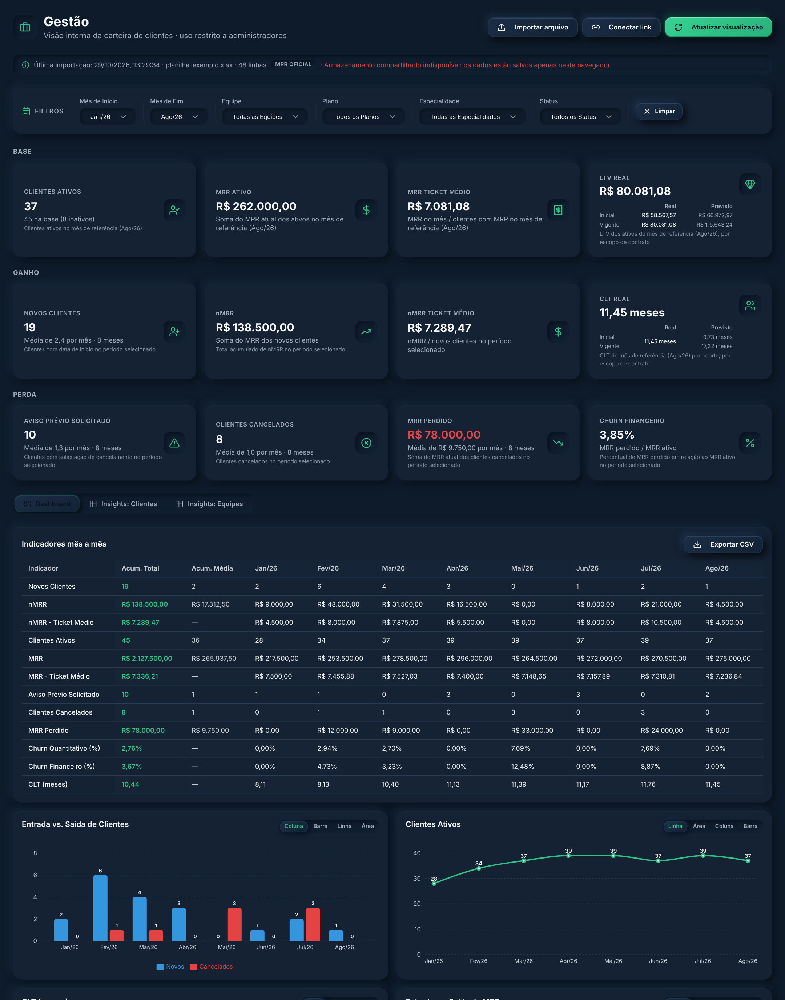
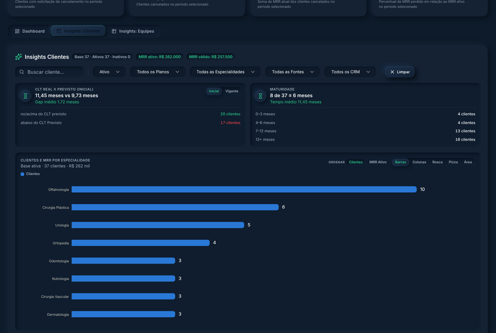
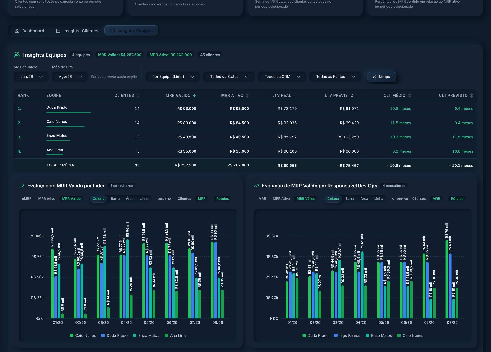

# Companium · Gestão

Protótipo da tela **Gestão** do [Companium](https://github.com/Felipe-Satler/companium), a plataforma interna de analytics e operação que desenvolvi na **Groohub**. É o painel da carteira de clientes da agência: lê a planilha de gestão e calcula, mês a mês, clientes ativos, MRR, churn, tempo de casa (CLT) e LTV, com recortes por equipe, plano, especialidade e fonte de tráfego.



> Todos os clientes, pessoas e valores das imagens e da planilha de exemplo são fictícios.

## Funcionalidades

- **Importação da planilha** por upload (.xlsx) ou link "Publicar na web" do Google Sheets, com cruzamento entre abas por ID e por nome.
- **KPIs em três blocos**: base (ativos, MRR, ticket médio, LTV), ganho (novos clientes, nMRR) e perda (avisos prévios, cancelamentos, MRR perdido, churn financeiro).
- **CLT e LTV real × previsto**, separados entre contrato inicial e contrato vigente, com dados inválidos fora das médias e sinalizados.
- **Indicadores mês a mês** em tabela, com exportação para CSV.
- **Insights por cliente**: maturidade da carteira e distribuição por especialidade, plano, fonte de tráfego e CRM.
- **Insights por equipe**: ranking por líder e evolução do MRR por responsável de RevOps, performance, copy e design.

<details>
<summary>Mais telas</summary>




</details>

## Regras de cálculo

O [`LOGICA.md`](LOGICA.md) documenta cada cálculo de forma que dê para reproduzir os números na mão a partir da planilha. O objetivo era que a tela batesse 100% com as fórmulas da planilha oficial da operação.

## Rodando localmente

```bash
npm install
npm run dev
```

Depois clique em **Importar arquivo** e escolha [`exemplo/planilha-exemplo.xlsx`](exemplo/planilha-exemplo.xlsx). Os dados ficam salvos só no navegador. Para guardar no banco, há um schema em [`sql/gestao_tables.sql`](sql/gestao_tables.sql).

## Stack

React 19, TypeScript, TanStack Start, Vite, Tailwind, shadcn/ui, Recharts e SheetJS para ler a planilha.

## Como foi feito

A tela foi construída no Lovable e depois levada para o Companium. A definição dos indicadores, a conferência dos números contra a planilha oficial e os testes de cada funcionalidade foram feitos por mim.

---

Desenvolvido por **Felipe Satler** · Groohub, 2026
